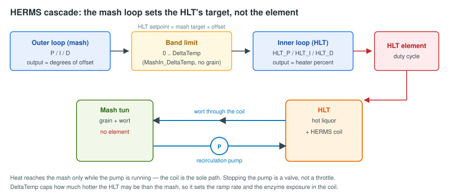

# HERMS control (PID\_HERMS)

`PID_HERMS` controls a mash tun that has **no element of its own**. The wort is
recirculated through a coil sitting in the hot liquor tank, so the only way to
heat the mash is to make the HLT hotter than the mash and keep wort moving
through the coil.

That single fact explains almost everything about how this plugin behaves.

## The cascade

Two PID loops run in series:

| Loop | Input | Output | Gains |
| --- | --- | --- | --- |
| **Outer** (mash) | mash temperature vs mash target | **degrees** of HLT offset | `P` `I` `D` |
| **Inner** (HLT) | HLT temperature vs the setpoint above | **heater percent** | `HLT_P` `HLT_I` `HLT_D` |

The outer loop's output is *not* a heater power. It is how much hotter than the
mash target the HLT should be right now. Full demand asks for
`mash_target + DeltaTemp`; as the mash approaches its target the offset eases
back, so at rest the HLT sits close to the mash temperature.


**Do not put PID AutoTune values into `P`, `I` and `D`.** Those are
degrees-per-degree, not percent-per-degree. AutoTune output belongs in
`HLT_P`, `HLT_I` and `HLT_D`. Sensible outer values are around `P=2.0`,
`I=0.005`, `D=0.0`. A heater-percent gain in `P` pins the HLT at its band limit
permanently, and the plugin will warn you if it sees one.


## `DeltaTemp` — the most important setting you own

`DeltaTemp` is how much hotter than the mash target the HLT is allowed to get.
It is a direct trade:

* **Lower** tracks the mash tightly and is gentle on enzymes, but ramps slowly.
* **Higher** ramps faster, but the wort in the coil sees a hotter surface, which
  risks denaturing enzymes.

It is entirely system-dependent — insulation, hose length, coil surface area and
pump flow all change the right answer. Tune it to your rig.

Measured on a 30 L mash tun / 40 L HLT with a 6.5 kW element, heating water to a
163 °F strike:

| `DeltaTemp` | Total ramp | Time in the final 5 °F |
| --- | --- | --- |
| 5.4 °F | 64.2 min | 13.6 min (21 % of the ramp) |
| 12 °F | 54.4 min | 5.2 min |
| 18 °F | 52.9 min | 3.8 min |
| 25 °F | 52.1 min | 3.0 min |

Returns flatten beyond about 18 °F, because the element saturates — past that
point a wider band buys nothing.


**`DeltaTemp` is a temperature *difference*, so converting it between scales is
a ratio, not the usual formula.** 3 °C of band is 5.4 °F, not 37.4 °F. The
historical default of `3` was a Celsius value; on a Fahrenheit server it is
converted to 5.4 automatically, and the conversion is logged.


### `MashIn_DeltaTemp` — a wider band while the tun holds only water

During Mash In there is no grain in the tun, so there are no enzymes to
protect — the compromise `DeltaTemp` represents is being paid for a risk that
does not exist yet, and it is paid almost entirely on the final few degrees.

Set `MashIn_DeltaTemp` to use a wider band for that step only. Leave it blank to
use `DeltaTemp` and change nothing.

The wider band applies **only** from the start of Mash In until strike
temperature is reached, which is exactly the window in which the tun is known to
be grain-free. From the moment the step prompts you to dough in, the normal band
is back.

## The pump

### Pump rest

| Property | Default | Meaning |
| --- | --- | --- |
| `Pump_Rest` | `Yes` | Whether to pause the pump periodically |
| `Rest_Interval` | 600 s | How long the pump runs between rests |
| `Rest_Time` | 60 s | How long each rest lasts |

Set `Pump_Rest` to `No` if your pump is rated for continuous duty and you would
rather not have it stop.


**While the pump is resting, the HLT setpoint is clamped to the mash target.**

Wort trapped in the coil has no flow and a lot of surface area against hot
liquor, so it heads toward HLT temperature — and a slug of overheated wort is
pushed into the mash when the pump restarts. On a sixty-minute rest with the
default settings, that would happen five times. Clamping while nothing is moving
means the trapped wort tends toward exactly the temperature it should be.


### The pump stops for dough-in

When Mash In reaches strike temperature it stops the recirculation pump so you
can dough in. Grain should go into a still tun rather than be drawn into a coil
that has no grain bed in front of it yet.

It also bounds the overshoot of a fast ramp. The coil is the only heat path, so
stopping the pump cuts that path immediately — where a heating element would
coast. Measured driving the HLT flat out to strike:

| Pump at strike | Mash overshoot past strike |
| --- | --- |
| keeps running | **+3.0 °F** |
| stops | **−0.1 °F** |

The pump restarts when you press Next. Set `Stop_Pump_At_Strike` to `No` on the
Mash In step to keep circulating instead.

## Seeing what the cascade is doing

Set `HLT_Kettle` to your HLT and the cascade will publish the setpoint it is
actually driving the HLT to.

Without it the interface shows the HLT's own configured target, which during a
cascade is not what is being asked for — a plausible-looking number that means
nothing. The original value is restored when the mash step ends.

## Sensor handling

| Property | Default | Meaning |
| --- | --- | --- |
| `Sensor_Stale_Seconds` | 300 | How long a reading may stay **unchanged** before it is treated as a frozen probe |

A reading is rejected — and the heater switched off with a notification — when
it is missing, non-numeric, not a finite number, older than the sensor's
allowance (see [Safety behaviour](safety.md)), or unchanged for longer than
`Sensor_Stale_Seconds`.

The unchanged check allows for probe resolution: a 12-bit DS18B20 steps in about
0.11 °F, so two adjacent counts are treated as "unchanged" rather than as
movement. Five minutes is long enough that a genuinely stable mash never trips
it, and short enough to bound how long the HLT can be driven against a frozen
number.


On a sensor fault the published HLT setpoint is also clamped back to the mash
target, so no other logic can act on an elevated setpoint that this plugin
produced while declaring its own sensors untrustworthy.


## Temperature limits

| Property | Purpose |
| --- | --- |
| `Max_PID_Temp` | Above this, run at `Max_Output` instead of using the PID — the mashout ramp |
| `Max_Boil_Temp` | Above this, hold `Max_Boil_Output` — controlled boiling |
| `Max_Pump_Temp` | Above this, the pump stops |

These were historically Celsius values (88, 88, 98). On a Fahrenheit server they
are converted to 190.4, 190.4 and 208.4 — these are absolute temperatures, so
the full conversion applies, unlike `DeltaTemp`.

## Troubleshooting

| Symptom | Likely cause |
| --- | --- |
| Mash sits a degree or two below target forever | `DeltaTemp` too small for the rig — the plugin warns when the HLT is pinned at the band limit while the mash has stopped rising |
| Mash overshoots at every step change | `DeltaTemp` too large, or outer `P` too high |
| HLT roars to its limit immediately | AutoTune values in `P` instead of `HLT_P` |
| Mash temperature spikes when the pump restarts | Pump rest with an older build that did not clamp the setpoint |
| "heating is not working" during a ramp | See the heat-stall watch in [Safety behaviour](safety.md) |
